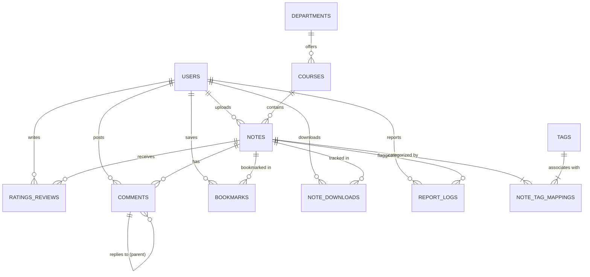

# Student Notes Sharing System (SQL Database)

A complete, production-ready relational database schema designed for a **Student Notes Sharing Platform**. This system allows students and instructors to upload, organize, search, download, bookmark, rate, review, and discuss academic notes and study materials.

---

## 🗂️ Project Structure

| File | Description |
| :--- | :--- |
| [`schema.sql`](file:///c:/Users/DELL/OneDrive/Desktop/Student-Notes-Sharing-system/schema.sql) | Production schema for **MySQL / MariaDB / PostgreSQL** (with indices, ENUMs, triggers, and views). |
| [`schema_sqlite.sql`](file:///c:/Users/DELL/OneDrive/Desktop/Student-Notes-Sharing-system/schema_sqlite.sql) | Portable schema for **SQLite** (standard ANSI SQL types and check constraints). |
| [`seed_data.sql`](file:///c:/Users/DELL/OneDrive/Desktop/Student-Notes-Sharing-system/seed_data.sql) | Realistic sample data (departments, courses, users, notes, tags, ratings, comments). |
| [`queries.sql`](file:///c:/Users/DELL/OneDrive/Desktop/Student-Notes-Sharing-system/queries.sql) | Essential application queries (search, filter, dashboards, leaderboard, moderation). |
| [`test_database.py`](file:///c:/Users/DELL/OneDrive/Desktop/Student-Notes-Sharing-system/test_database.py) | Python verification script to spin up and test the database in one second. |

---

## 📊 Entity Relationship (ER) Diagram



---

## 🏛️ Database Tables Overview

1. **`users`**: Manages credentials, roles (`student`, `faculty`, `admin`), profile details, and university affiliation.
2. **`departments`**: Academic faculties/branches (e.g., Computer Science, Electrical Engineering).
3. **`courses`**: Course catalog mapped to departments and semesters (e.g., `CS101`, `MATH101`).
4. **`notes`**: Master repository of note metadata: title, description, file format, cloud file URL, total pages, status (`pending`, `approved`, `rejected`), download/view counters.
5. **`tags` & `note_tag_mappings`**: Many-to-many tag tagging system (`cheatsheet`, `midterm-prep`, `handwritten`, etc.).
6. **`ratings_reviews`**: 1-to-5 star ratings with feedback text (preventing duplicate reviews per user per note).
7. **`comments`**: Discussion thread under each note with support for nested/threaded replies.
8. **`bookmarks`**: Student personal saved collection for quick study access.
9. **`note_downloads`**: Audit log recording downloads with timestamps and IP addresses for statistics.
10. **`report_logs`**: Content moderation flags for inappropriate or copyrighted material.

---

## 🚀 Quick Start / How to Run

### Option 1: Instant Test using SQLite (No setup required)
Run the automated verification script:
```bash
python test_database.py
```
This builds `notes_sharing.db`, seeds sample data, and runs verification queries.

### Option 2: MySQL / MariaDB (Workbench, phpMyAdmin, or CLI)
1. Open your MySQL client or terminal:
   ```bash
   mysql -u root -p
   ```
2. Create database and load the schema:
   ```sql
   CREATE DATABASE notes_sharing_db;
   USE notes_sharing_db;
   SOURCE schema.sql;
   SOURCE seed_data.sql;
   ```

### Option 3: PostgreSQL
Import using `psql`:
```bash
createdb notes_sharing_db
psql -d notes_sharing_db -f schema_sqlite.sql
psql -d notes_sharing_db -f seed_data.sql
```

